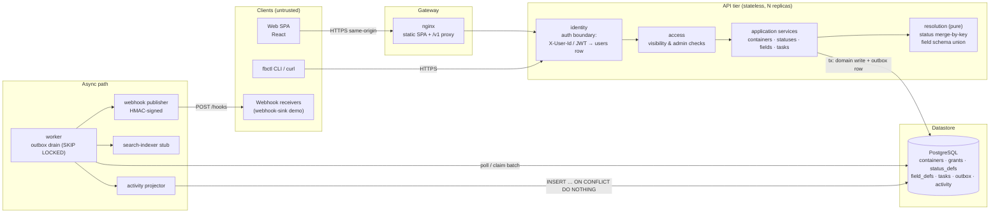
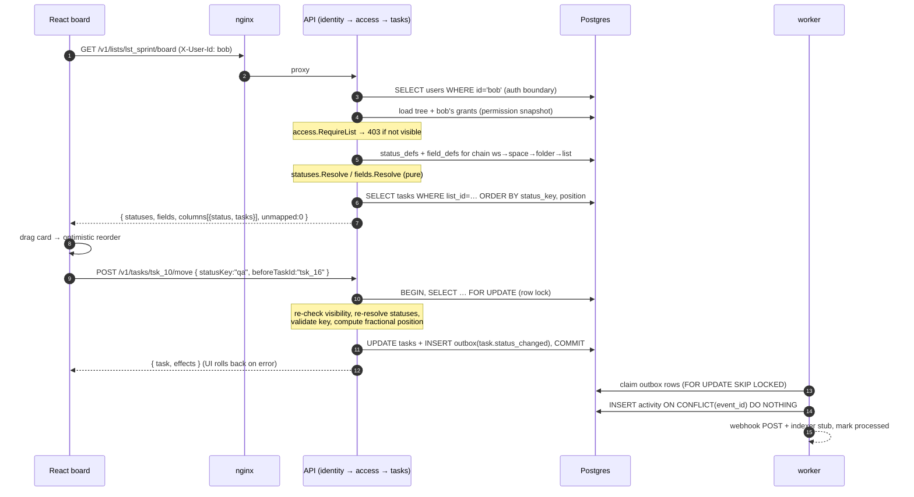
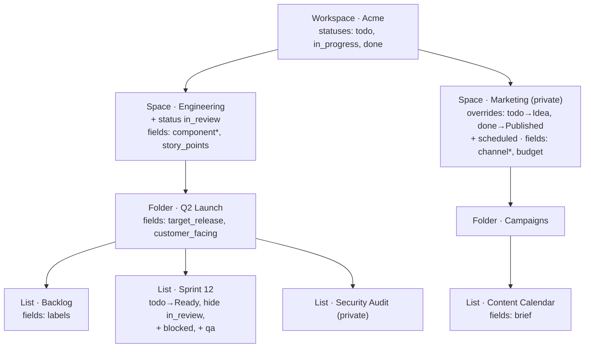
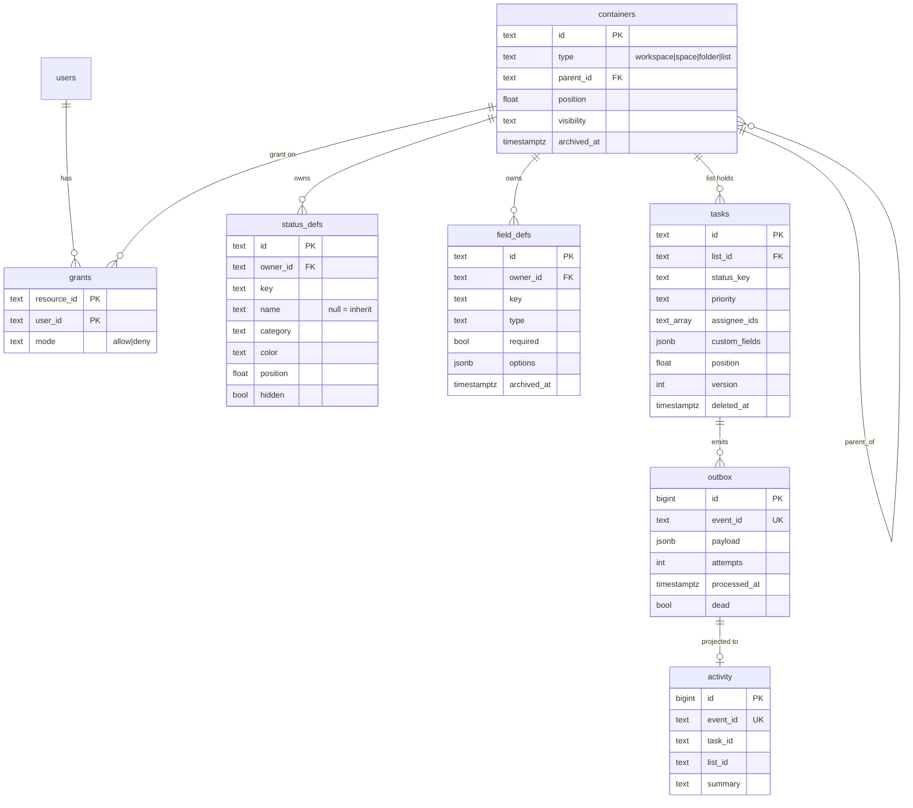

# Flowboard

A mini project-management app for one team: a workspace → space → folder → list hierarchy, tasks with
custom fields, status sets that vary by scope, a kanban board and a list view, and a simple permission model.

**Stack:** Go 1.24 API (chi, database/sql + lib/pq, no ORM) · React 18 + TypeScript (Vite, dnd-kit) · PostgreSQL 16 ·
nginx gateway · a background worker draining a transactional outbox · Docker Compose.

---

## 1. Run it

```bash
cp .env.example .env        # optional; defaults work without it
docker compose up --build
```

| Service        | URL / port                    | What it is |
|----------------|-------------------------------|------------|
| `web`          | http://localhost:3000         | React SPA behind nginx; nginx proxies `/v1` to the API (same origin) |
| `api`          | http://localhost:8080/v1      | REST API. `GET /v1/openapi.yaml` serves the contract |
| `worker`       | –                             | Drains the outbox → activity feed, webhooks, search-indexer stub |
| `webhook-sink` | –                             | Demo third-party receiver; verifies HMAC signatures and logs events |
| `seed`         | one-shot                      | Applies migrations and seeds demo data on first boot (idempotent) |
| `db`           | localhost:5432                | Postgres 16 (`flowboard` / `flowboard`) |

**Users** (pick one with the “Acting as” switcher at the bottom of the sidebar):

| User  | Role   | Sees |
|-------|--------|------|
| alice | admin  | everything; can change statuses, fields, containers and grants |
| bob   | member | Engineering (Backlog, Sprint 12) + the private **Marketing** space (allow grant). Not Security Audit |
| carol | member | Sprint 12 + the private **Security Audit** list (allow grant). **Backlog** is explicitly denied |

**Make targets** (all run in Docker): `make up`, `make test` (Go + frontend tests), `make e2e` (Playwright against
the running stack, reseeds first), `make seed` (wipe + reseed), `make cli ARGS="board lst_sprint" AS=bob`, `make logs`.

### Hosted demo (no install)

[](https://render.com/deploy?repo=https://github.com/VivekBisht2103/flowboard)

The root [`Dockerfile`](Dockerfile) builds a single container in which one Go process serves the React app, the
`/v1` API and the outbox worker; [`render.yaml`](render.yaml) pairs it with a free Postgres. The same image runs on
any Docker host:

```bash
docker build -t flowboard . && docker run -p 8080:8080 -e DATABASE_URL=postgres://… flowboard
```

| Env var | Effect in the single container |
|---|---|
| `SEED_ON_START=true` | Run migrations and seed an empty database on boot |
| `RUN_WORKER=true` | Run the outbox worker in-process (activity feed, webhooks) |
| `STATIC_DIR=/app/web` | Serve the built SPA on the same origin as the API |
| `DEMO_RESET_EVERY=6h` | Wipe and re-seed on a timer, so testers can't break the demo for each other |

The hosted demo keeps the mock identity on (anyone can pick Alice, Bob or Carol), which suits a shared demo
but not real data. Free-tier caveats: the service sleeps after ~15 minutes idle, so the first request takes about
a minute; the free database expires after 30 days.

### Demo path (what the video walks through)
1. `docker compose up --build`, open http://localhost:3000 as Alice.
2. Sidebar: Engineering → Q2 Launch → **Backlog** shows *To Do · In Progress · In Review · Done*.
   **Sprint 12** (sibling list) shows *Ready · Blocked · In Progress · QA · Done*: it renames `todo`, hides the
   space's `in_review`, and adds `blocked` and `qa`.
3. Drag a card between columns; open it; change *Story Points* or *Component*; **Save changes**. The activity feed
   at the bottom of the drawer fills in once the worker has processed the event.
4. Click **Engineering** → *Statuses & fields*: the space's own `in_review` status and its two fields; workspace
   defaults are marked as inherited. On **Sprint 12**, try deleting **QA** — the app asks where the QA tasks should go.
5. Switch “Acting as” to Bob: *Security Audit* disappears and the config screens become read-only. Switch to Carol:
   *Backlog* disappears, *Security Audit* appears.

---

## 2. System design



**Trust boundaries**
1. *Client → API.* Everything a client sends is untrusted. The identity middleware turns `X-User-Id` or a bearer JWT
   into a `users` row and rejects anything else with **401**. The role always comes from the database; a role claim
   in a JWT or a `role` field in a body is ignored (unknown body fields are rejected with 400).
2. *API → database.* The only writer of domain state. Every permission decision happens in `internal/access`
   **before** a service touches the database, using a per-request snapshot (tree + the caller's grants).
3. *Worker → third parties.* Outbound webhooks are signed (`X-Flowboard-Signature: sha256=…`) and carry
   `X-Flowboard-Event-Id` for receiver-side dedupe.

### Request flow: “load board + drag card”



### Where configuration lives relative to the hierarchy



Status and field definitions are rows owned by a container (`owner_id`). They are **never copied down**; a list's
effective configuration is computed on read by walking its ancestor chain (`statuses.Resolve`, `fields.Resolve`),
so a change at the space is visible on every list below it immediately.

---

## 3. Data model



Schema: [`backend/migrations/0001_init.sql`](backend/migrations/0001_init.sql), applied by an embedded migrator
guarded by a Postgres advisory lock (safe with several replicas starting at once).

- **One `containers` table** for all four levels, with a `CHECK` that only the workspace has no parent and a
  service-level rule for valid parent types (space→workspace, folder→space, list→folder). Lists hold tasks; nothing
  else does.
- **Ordering** uses fractional `position` (doubles). Inserting between two neighbours takes the midpoint; when the
  gap drops below 1e-6 the column is renumbered in the same transaction (tested by hammering one gap 80 times).
- **Soft delete.** Containers: `DELETE` archives the container and its whole subtree with one timestamp (so an
  un-archive can restore exactly that set). Tasks: `deleted_at`. Archived/deleted rows are invisible to the API.

### Status inheritance — the exact algorithm (merge by key)

Tasks store a stable **`statusKey`** (keys are immutable; renames change `name` only).
For a list, walk the chain **workspace → space → folder → list**; at each level apply that owner's rows:

| Row at this level | Effect on the working set |
|---|---|
| `hidden = true` | remove the key (if present) |
| key already in the set | **override**: every non-null attribute (`name`, `color`, `category`, `position`) replaces the inherited value |
| key not in the set, row complete (`name`+`category`+`color`) | **add** a new status |
| key not in the set, row incomplete | ignored (an orphaned override whose base was deleted) |

Finally sort by `(position, key)`. That list *is* the kanban column set and the validation set.
A hidden key can be re-introduced deeper down by a complete row. Implementation: `backend/internal/statuses/resolve.go`
(pure function, unit-tested).

**Invariants enforced on every status mutation** (`statuses/service.go → validateAndRemap`), inside one transaction
under a per-workspace config lock: after applying the change, every list in the owner's subtree is re-resolved and
1. must still contain ≥1 `not_started`, ≥1 `active`, ≥1 `done` status → else **422 `STATUS_SET_INVALID`** (rolled back);
2. no live task may reference a key that no longer resolves in its list → else **409 `STATUS_IN_USE`** listing every
   affected list and task count, *unless* `remapTo=<key>` is given and that key is valid in every affected list; then
   those tasks are moved (appended to the target column) and a `status.remapped` event is emitted.

This is why the board endpoint's `unmapped` counter is always 0, and the tests assert it.

### Custom-field resolution

- Schema for a list = **union** of field definitions on its space, folder and the list itself, ordered by depth then
  position. Fields live on spaces, folders and lists (not the workspace).
- **Key collisions are rejected, not merged:** a key may appear at most once along any root-to-leaf path. Creating
  `component` on a list under a space that already defines it — or defining `labels` on a folder when a child list
  has it — returns **409 `FIELD_KEY_CONFLICT`** naming the conflicting owner. Unrelated branches may reuse a key.
- Values are stored in `tasks.custom_fields` (JSONB) keyed by field key; select values store option **ids** (labels
  can be renamed freely). Validation (`fields/resolve.go → Apply`) reports every problem with a JSON path:
  `customFields.story_points` `INVALID_TYPE`, `customFields.labels[1]` `INVALID_OPTION`, `UNKNOWN_FIELD`, `REQUIRED`.
  `null` clears a value; `""` / `[]` are normalised to “cleared”; dates are normalised to `YYYY-MM-DD`.
- **Required** is enforced on create, on every update (you can't clear it), and on move into a list that requires it.

### Policies for the hard cases

| Case | Policy | Test |
|---|---|---|
| Move task to a list whose set lacks its status | `statusKey` in payload wins → else `statusPolicy=map_to_default` (default): first destination status **with the same category**, else first `not_started` → else `statusPolicy=reject`: 409 `STATUS_NOT_IN_TARGET` with the valid keys. Both policies tested | `TestMove_StatusMissingInTarget_*` |
| Delete / hide a status tasks still use | Reject with 409 `STATUS_IN_USE` (per list, with counts) or remap atomically with `remapTo` | `TestConfigSafety_DeleteInUseStatus*`, `…HidingInheritedStatusChecksEveryDescendantList` |
| Change leaves a list without a done/active/not-started status | 422 `STATUS_SET_INVALID`, nothing changes | `TestConfigSafety_CannotRemoveLastDoneStatus` |
| Move task to a list where a required field is missing | 400 `VALIDATION_FAILED` (`customFields.channel` `REQUIRED`) unless supplied in the move payload's `customFields` | `TestMove_RequiredFieldMissingInDestination…` |
| Values for fields the destination doesn't have | **Stripped** and reported in `effects.strippedFields` (moving back does not resurrect them) | `TestMove_StripsFieldValuesNotInDestinationSchema` |
| Delete a field definition | Archive the definition and **strip** its values from every task in scope, same transaction | `TestConfigSafety_DeleteFieldStripsValues` |
| Remove a select option tasks use | 409 `OPTION_IN_USE` (relabelling an option keeps its id and is fine) | `TestConfigSafety_RemovingSelectOptionInUseIs409` |
| Make an existing field required | 409 `FIELD_REQUIRED_BACKFILL` with a count, or pass `defaultValue` to backfill atomically | `TestRequiredFields_MakingFieldRequiredNeedsBackfill` |
| Change a field's type or key | 400 `IMMUTABLE` — model it as delete + create | `TestConfigSafety_FieldKeyCollision…` |
| Concurrent edits | Optional `version` on PATCH/move → 409 `VERSION_CONFLICT` | `TestTask_StatusChangeAppendsToColumnAndBumpsVersion` |

---

## 4. API

REST, resource-oriented, versioned under **`/v1`**. Full contract: [`backend/openapi/openapi.yaml`](backend/openapi/openapi.yaml)
(served at `GET /v1/openapi.yaml`). `TestOpenAPIMatchesRouter` walks the chi router and fails if a route is served but
undocumented, or documented but not served.

| Method & path | Purpose |
|---|---|
| `POST /v1/auth/token` | Dev token issuer → short-lived HS256 JWT |
| `GET /v1/me`, `GET /v1/users` | Caller; members for assignee pickers |
| `GET /v1/tree` | Hierarchy filtered to what the caller can see |
| `POST /v1/containers` · `GET/PATCH/DELETE /v1/containers/{id}` | Create / read / rename+visibility / archive |
| `GET /v1/containers/{id}/children` | Cursor-paginated children |
| `POST /v1/containers/{id}/move` | Reorder among siblings (`beforeId` / `afterId`) |
| `GET /v1/containers/{id}/grants` · `PUT/DELETE …/grants/{userId}` | Permission grants (admin) |
| `GET/POST /v1/containers/{id}/statuses` · `PATCH/DELETE …/statuses/{key}` · `PUT …/statuses/order` | Scoped status config (local / inherited / resolved views; `?remapTo=`) |
| `GET/POST /v1/containers/{id}/fields` · `PATCH/DELETE …/fields/{fieldId}` | Custom-field definitions |
| `GET /v1/lists/{id}/resolved-statuses` · `GET /v1/lists/{id}/resolved-fields` | Effective config for a list |
| `GET /v1/lists/{id}/board` | Board aggregate: statuses + schema + tasks per column, one round trip |
| `GET /v1/lists/{id}/tasks` · `POST /v1/lists/{id}/tasks` | List (sort/filter/paginate) · create |
| `GET/PATCH/DELETE /v1/tasks/{id}` | Read / merge-patch / soft delete |
| `POST /v1/tasks/{id}/move` | Move across lists, columns and positions (“drag card”) |
| `GET /v1/tasks/{id}/activity` · `GET /v1/lists/{id}/activity` | Activity feed (eventually consistent) |

**Standardisation**
- **Errors:** always `{ "error": { "code", "message", "details" } }`; validation details are
  `fieldErrors: [{ path, code, message }]`. 400 validation · 401 unauthenticated · 403 forbidden · 404 unknown id ·
  409 conflict with current state · 422 config change would leave a list invalid.
- **Pagination:** `{ data, page: { nextCursor, limit } }`. Keyset on `(sortExpr, id)`; the cursor is opaque base64 JSON
  bound to the sort it was issued for (replaying it under another sort → 400). Nulls sort last for `dueDate` in both
  directions; `priority` asc = urgent first.
- **Filters:** `cf.<fieldKey>=<value>` on the list and board endpoints (e.g. `cf.component=backend`), validated against
  the list's schema and executed as GIN-indexable `custom_fields @> '{"key": value}'`.
- **Commands as sub-resources** where a verb is genuinely not CRUD (`/move`), with an `effects` object describing side
  effects (status mapping, stripped fields, remaps) instead of hiding them.
- **Strict bodies:** unknown JSON fields → 400 (so `{"role":"admin"}` can't sneak in).

---

## 5. Auth

- **Now (mock identity, real boundary):** `X-User-Id: alice|bob|carol` *or* `Authorization: Bearer <jwt>` where the
  JWT (`{userId, role, iat, exp}`, HS256, 15-minute TTL) comes from `POST /v1/auth/token`. If both are sent they must
  agree. The user is loaded from the `users` table on every request; the role claim is informational and never used
  for decisions (`TestAuth_JWTRoundTripAndRoleClaimIsNotTrusted` signs a token claiming `admin` for Bob and gets 403).
  Missing/unknown/expired/tampered credentials → 401; authenticated but not allowed → 403.
- **Production swap (OIDC):** replace `identity.Service.Authenticate` only.
  1. The SPA does Authorization Code + PKCE against the IdP (Okta/Auth0/Entra); the gateway or a small BFF keeps the
     tokens in an HttpOnly, SameSite cookie session (no tokens in JS).
  2. The API verifies the access token's signature against the IdP's JWKS (cached, rotated), checks `iss`, `aud`,
     `exp`, then maps `sub` → `users.external_id` (JIT-provision on first login).
  3. Set `AUTH_ALLOW_HEADER=false` and `AUTH_DEV_ISSUER=false`. Roles stay in our database (or are synced from IdP groups);
     nothing downstream of `identity.FromContext` changes.
  4. CLI/automation use OAuth device flow or per-user personal access tokens, scoped and revocable.

---

## 6. Multi-channel

| Channel | Status | Notes |
|---|---|---|
| Web SPA (React) | built | Primary channel |
| CLI `fbctl` | built (`backend/cmd/fbctl`) | Same `/v1` endpoints and auth; `tree`, `board`, `tasks --sort --cf`, `create`, `status`, `move --policy`, `token` |
| curl | documented | [`docs/curl-cookbook.md`](docs/curl-cookbook.md) |
| Webhooks | built | Worker POSTs signed `task.*` / `status.remapped` / `field.deleted` events; [`docs/webhooks.md`](docs/webhooks.md) has payloads and the receiver contract; `webhook-sink` verifies and logs them |

**Boundaries.** Shared across channels: the `/v1` contract, auth, error envelope, pagination, validation and the
event schema (`schemaVersion: 1`). UI-only: optimistic drag state and rollback, the “Acting as” switcher (a dev
convenience that only changes `X-User-Id`), toasts, the remap prompt, collapsed sidebar state. `GET /v1/lists/{id}/board`
is a read aggregate shaped for any board-style client (mobile included) rather than a private SPA endpoint; a mobile
client would add a thin BFF only if it needed a different shape (e.g. column counts without task bodies).

---

## 7. Scalability and service boundaries

**Module boundaries in the monolith** (Go packages; each owns its tables and exposes a service):
`identity` (users, tokens) · `access` (grants → decisions; no SQL writes) · `hierarchy`/`containers` (tree) ·
`statuses` and `fields` (config + pure resolution) · `tasks` (task lifecycle, board/list reads) · `events`
(outbox, worker, activity). Cross-module writes are explicit and few: config changes remap or strip task values
inside the same transaction, which is the one place the modules are intentionally coupled.

**Stateless API.** No in-process session or cache; every request re-derives identity and the permission snapshot
from Postgres, so `docker compose up --scale api=3` behind a load balancer just works. The worker scales the same way
(`FOR UPDATE SKIP LOCKED` makes multiple workers safe).

**Indexes / query notes** (all in `0001_init.sql`):
- Tree: `containers (parent_id, position, id) WHERE archived_at IS NULL`. The whole tree is one indexed query per
  request — fine for thousands of nodes. Next step: cache the tree per workspace keyed by a `tree_version` counter
  bumped on hierarchy/grant writes, and add a materialised path (`ltree`) for subtree queries.
- Board: `tasks (list_id, status_key, position, id) WHERE deleted_at IS NULL` serves the board in index order.
  Board responses cap at 1,000 tasks (`truncated: true`); beyond that, columns paginate individually.
- List view: one keyset index per sortable column (`COALESCE(due_date,'infinity')`, `priority_rank` — a generated
  column — and `created_at`), each `(list_id, expr, id)`.
- Custom-field filters: `GIN (custom_fields jsonb_path_ops)` makes `@>` equality filters index-backed. Range filters
  (`story_points > 5`) would need expression indexes per hot field or a typed `task_field_values` side table.
- Status/field resolution reads at most ~4 owners' rows per list (`owner_id = ANY(chain)`); cacheable by
  `(list_id, config_version)`.

**What I'd split out in weeks 2–4, and why**
1. **Activity / audit service** — already behind the outbox; becomes its own deployable consuming a log (Kafka/NATS
   JetStream) so retention and query load don't touch the task DB.
2. **Search** — the indexer stub becomes a consumer feeding OpenSearch/Meilisearch for full-text and custom-field
   range queries.
3. **Notifications / webhooks** — fan-out, per-subscriber retries and rate limits shouldn't share a worker with the
   activity projection.
4. **Permissions** as a library first, then a service (Zanzibar/OpenFGA-style) once teams and nested groups arrive —
   the `access.Evaluator` interface is the seam.
Tasks, hierarchy and config stay together: they share invariants that need one transaction.

## 8. IPC and failure modes

Built: **transactional outbox + polling worker** (a second process). Domain writes and their event row commit in
the same Postgres transaction, so there is no dual-write gap.

- **At-least-once delivery.** The worker claims a batch with `FOR UPDATE SKIP LOCKED`, runs consumers inside a
  savepoint, then marks rows processed. A crash between side effect and ack causes redelivery.
- **Idempotency.** Activity insert is `ON CONFLICT (event_id) DO NOTHING`; webhooks carry `X-Flowboard-Event-Id` for
  receiver dedupe (the sink flags duplicates). Tested by clearing `processed_at` and redraining.
- **Retries.** Exponential backoff (2^attempt seconds); after 8 attempts the row is marked `dead` with `last_error`
  for manual replay. A failing consumer rolls back the other consumers' writes for that event (savepoint), tested.
- **Eventual consistency.** The activity feed lags writes by one poll interval (~500 ms). The UI says so (“Changes
  appear here once the worker processes them”) and never reads it for decisions. Board/task reads are strongly
  consistent from the primary.
- **Next:** swap polling for `LISTEN/NOTIFY` wake-ups, then for a log-based broker when consumers multiply; consumers
  keep the same `Event` contract.

---

## 9. Tests

```bash
make test          # Go (unit + integration against Postgres) and frontend (typecheck + Vitest), in Docker
make e2e           # Playwright against the running stack (make up first)
```

Locally: `cd backend && TEST_DATABASE_URL=postgres://…/flowboard_test go test ./...` · `cd frontend && npm test`.

| Area | Named scenarios |
|---|---|
| Permissions | `TestPermissions_TreeHidesPrivateNodesForBob`, `…AliceSeesAll`, `…CarolDiffersFromBob`, `…DeniedListReturns403OnTaskRead` (private list *and* explicit deny on a public list; unknown id → 404), `…MembersCannotChangeConfigButCanEditTasks`, `…GrantChangesTakeEffectImmediately` (deny on a folder beats an allow below) |
| Auth | `TestAuth_MissingCredentialsIs401`, `…UnknownUserIs401`, `…JWTRoundTripAndRoleClaimIsNotTrusted` (forged role, tampered, expired, header/token mismatch) |
| Status resolution | `TestStatusResolution_SiblingListsResolveDifferentColumnSets`, `…FolderOverrideFlowsToAllChildLists`; unit tests for override / hide / re-add / orphaned rows |
| Status validation | `TestTask_CreateWithUnknownStatusIs400`, `TestTask_UpdateWithUnknownStatusIs400` |
| Cross-list move | `TestMove_StatusMissingInTarget_MapToDefaultIsCategoryPreserving`, `…_RejectPolicyIs409AndNoChange`, `…ExplicitStatusKeyWinsAndIsValidated`, `…StatusPresentInTargetIsKept`, `…MemberCannotMoveIntoListTheyCannotSee`, `…ReorderWithinColumn`, `…RepeatedMidpointInsertsRenumberColumn` |
| Custom fields | `TestCustomFields_WrongTypeIs400WithFieldPath`, `…SelectValueNotInOptionsIs400`, `…UnknownKeyIs400`, `…ValidPayloadIsAcceptedAndNormalized`, `TestMove_StripsFieldValuesNotInDestinationSchema` |
| Required fields | `TestRequiredFields_CreateWithoutRequiredFieldIs400`, `…UpdateCannotClearRequiredField`, `…MakingFieldRequiredNeedsBackfill`, `TestMove_RequiredFieldMissingInDestination…` |
| Config safety | `TestConfigSafety_DeleteInUseStatusIs409AndBoardUnchanged`, `…WithRemapMovesTasks`, `…HidingInheritedStatusChecksEveryDescendantList`, `…CannotRemoveLastDoneStatus`, `…DeleteFieldStripsValues`, `…RemovingSelectOptionInUseIs409`, `…FieldKeyCollisionAcrossLevelsIs409AndTypeIsImmutable` |
| API contract | `TestOpenAPIMatchesRouter`, `TestAPI_CursorPaginationSortedByDueDateNullsLast`, `…PrioritySortAndCustomFieldFilter`, `…ErrorEnvelopeAndUnknownBodyFields` |
| Async | `TestOutbox_WorkerBuildsActivityIdempotently`, `…RolledBackWriteEmitsNothing`, `…FailuresBackOffThenDeadLetterWithoutPartialWrites` |
| Seed | `TestSeed_EveryListBoardIsConsistent` (every seeded task re-validates; 20+ tasks; no unmapped) |
| Frontend (Vitest) | select list → expected kanban columns → open task → edit custom field → save (asserts the PATCH payload); server field error shown next to the field; Alice → Bob hides the private list; optimistic `applyMove` |
| E2E (Playwright) | sibling lists' columns differ; edit custom field persists across reload; drag card changes column and persists; Alice → Bob → Carol visibility |

---

## 10. Trade-offs, cuts, and next steps

**Stretch goals attempted (two):** filter list/board by custom-field values (`cf.<key>=`, GIN-indexed, UI filter on
the list view) and the activity feed via async IPC (outbox → worker → activity, plus signed webhooks). Optimistic
drag-and-drop with rollback came along with the board.

**Deliberate choices**
- *Merge-by-key* statuses instead of “override set replaces parent”: a list can rename one status without
  re-declaring the whole set, and parent additions still flow down.
- *Strip* (not hide) values on move and field deletion: no ghost data can reappear later; the response tells you what
  was removed.
- *403 for existing-but-hidden resources* as the spec asks. It confirms existence; switching to 404 is one line in
  `access.RequireView`.
- *Config is admin-only.* Simpler to reason about than per-container edit rights; members edit tasks in visible lists.
- *Single-workspace per DB* (seeded); `workspace_id` columns exist so multi-tenancy is a filter, not a migration.
- *No ORM*, hand-written SQL: the interesting queries (keyset, JSONB containment, window-function renumbering) are
  clearer as SQL.

**Cut / not done**
- Subtasks (`parentTaskId`). Re-parenting containers (needs the same validate-and-remap pass as status edits).
  Un-archive endpoint (data supports it). Status/field config for members with edit rights. Bulk edit, real-time
  updates, full-text search. Board columns are capped at 1,000 tasks per list rather than paginated per column.

**Day 5**: SSE stream of outbox events to the board (real-time), un-archive, per-column pagination, a Dockerised
seed-reset endpoint for E2E isolation, and a small demo video.
**Week 2**: OIDC (§5), teams + group grants with an `access` interface backed by OpenFGA, search service, typed
`task_field_values` for range filters, tree/config caching with version counters, observability (OpenTelemetry
traces across API → outbox → worker).

---

## 11. AI usage

See [AI_USAGE.md](AI_USAGE.md) for tools, what they generated, what was corrected and which AI-written tests had
to be fixed.

## Repository layout

```
backend/   cmd/flowboard (serve|worker|seed|migrate|webhook-sink) · cmd/fbctl · internal/<module> · migrations · openapi
frontend/  src/components (Board, ListView, TaskDrawer, ConfigPanel, Sidebar) · src/test (Vitest) · e2e (Playwright)
docs/      curl-cookbook.md · webhooks.md
deploy/    Postgres init (test database)
```
